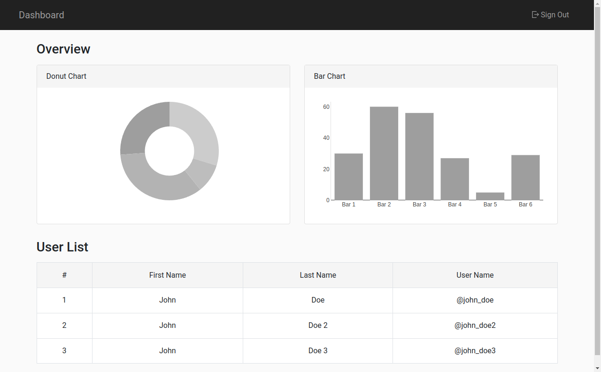
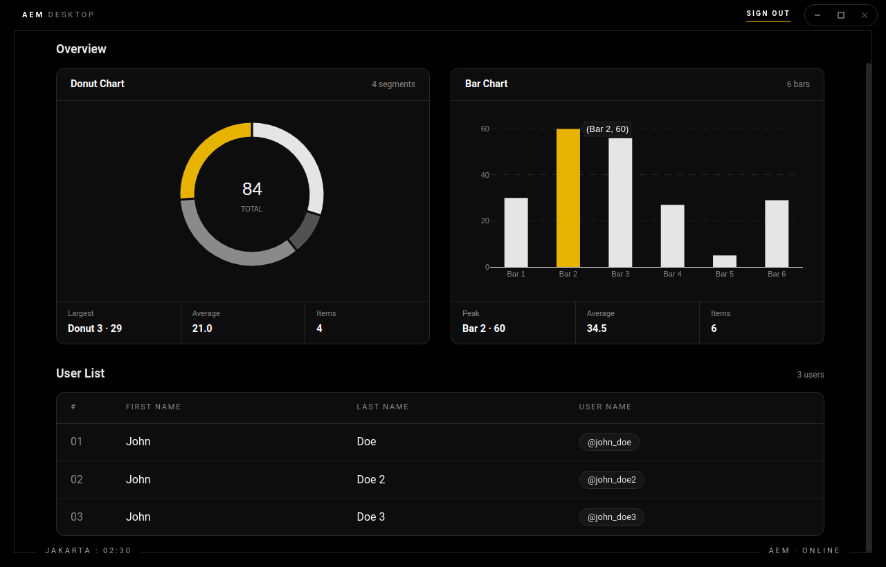

# AEM Interview Test

By **Al Maulana**

A dashboard built with Angular 14, which also runs as an Electron desktop app. It covers three tests:

| Test | Brief | Where |
| --- | --- | --- |
| Dashboard (Sign In + Dashboard) | [Angular.md](Angular.md) | `/#/sign-in`, `/#/dashboard` |
| Custom tagging input | [Tagging-Input.md](Tagging-Input.md) | `/#/form` |
| Electron desktop app | [Electron.md](Electron.md) | `npm run electron` |

| Web | Desktop (Electron) |
| --- | --- |
|  |  |

## Requirements

- **Node.js 16 LTS** (recommended for Angular 14). Newer versions also work but print a version warning.
- **npm** 8 or newer
- **Google Chrome** (only needed to run the unit tests)
- Internet access to `http://test-demo.aemenersol.com`

## Setup

```bash
git clone <repository-url>
cd <repository-folder>
npm install
```

## Run the web app

```bash
npm start
```

Open http://localhost:4200 and sign in with:

- **Username:** `user@aemenersol.com`
- **Password:** `Test@123`

| Page | URL | Notes |
| --- | --- | --- |
| Sign In | http://localhost:4200/#/sign-in | Form validation; the button stays disabled until the form is valid |
| Dashboard | http://localhost:4200/#/dashboard | Redirects to Sign In when not logged in |
| Tagging input | http://localhost:4200/#/form | Enter or comma adds a tag, Backspace removes the last one, × removes one |

## Run the desktop app

```bash
npm run electron        # build the app and open it in Electron
npm run electron:dev    # dev server + Electron with live reload
```

> **Running from the VS Code terminal?** VS Code sets `ELECTRON_RUN_AS_NODE`, which makes Electron start as plain Node. Unset it first:
>
> ```bash
> env -u ELECTRON_RUN_AS_NODE npm run electron
> ```

The desktop app uses a dark theme with a custom title bar (sign out, minimize, maximize, close). The browser version keeps the original design.

### Offline login (PouchDB)

1. Sign in once while online. Your credentials (as a SHA-256 hash) and the dashboard data are saved locally in PouchDB.
2. Sign out and disconnect from the network.
3. Sign in again with the same credentials. You are let in through PouchDB and the dashboard shows the last saved data, while the status bar shows `AEM · OFFLINE`.
4. A wrong password is still rejected.

## Run the tests

```bash
npm test                                            # watch mode in Chrome
npx ng test --watch=false --browsers=ChromeHeadless # single run
```

The unit tests cover login, getting and storing the token, the token interceptor, the route guard, the dashboard API call and the tagging input.

## Build

```bash
npm run build    # production build in dist/aem-dashboard
```

## How it works

- After a successful login, the API's bearer token is stored and added to every request by `TokenInterceptor`.
- `AuthGuard` protects the dashboard and sends unauthenticated users to Sign In.
- `TagInputComponent` implements `ControlValueAccessor`, so it works with both `formControlName` and `[(ngModel)]`. It reuses Bootstrap's `.form-control` styles.
- Electron runs with `contextIsolation` on and `nodeIntegration` off. The preload script only exposes the window controls.

## Project structure

```
src/app/
  core/          auth service, guard, token interceptor, PouchDB service
  shared/        tag input component
  sign-in/       sign in page
  dashboard/     dashboard page, chart component, dashboard service
  form/          sample form using the tag input
  title-bar/     custom window title bar (desktop only)
src/styles/      desktop theme
electron/        main process and preload script
```

## Tech stack

Angular 14, Bootstrap 4, Plotly.js, PouchDB, Electron, Jasmine and Karma.

## Troubleshooting

- **`Electron failed to install correctly`**: run `node node_modules/electron/install.js` or delete `node_modules` and run `npm install` again.
- **Port 4200 in use**: run `npx ng serve --port 4300`.
- **Dashboard shows "Failed to load dashboard data"**: check that `http://test-demo.aemenersol.com` can be reached from your network.
